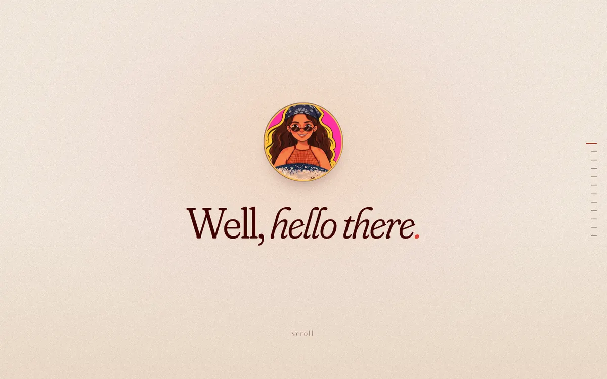
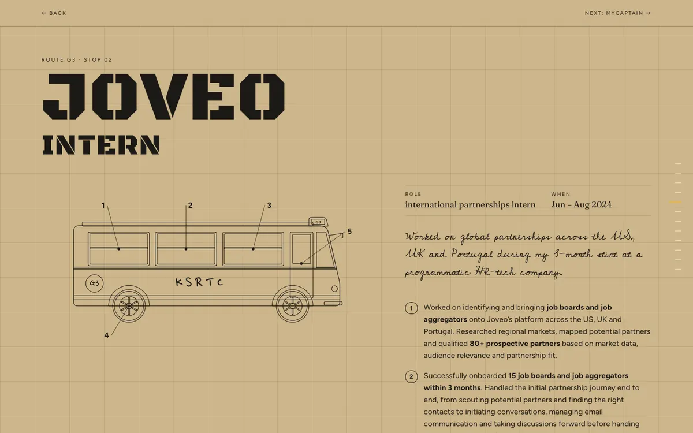
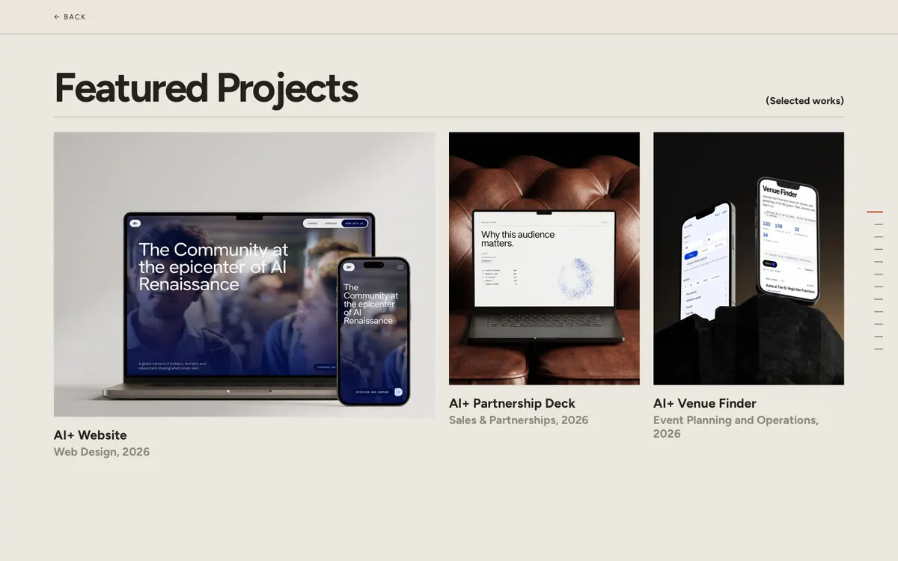
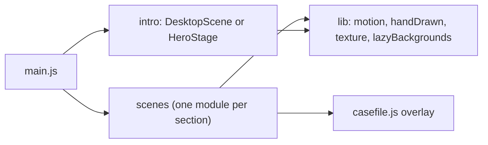

# Shreya Lahiri — portfolio

The source for [shreyalahiri.com](https://shreyalahiri.com): a personal portfolio that plays out as a scroll-driven story, with an opening film, a stage curtain, a wall calendar for work experience, a bus for early internships, and a few other set pieces.

It's plain HTML, CSS and ES modules. There's no framework, no bundler and no build step, so the files in this repo are exactly what the browser runs.

| Hello screen | A bus stop page | Website design |
| --- | --- | --- |
|  |  |  |

## What it does

- **Two intros, picked by device.** Laptops and desktops get a scene built live from the original artwork's layers, on a 10-second timeline. Phones and tablets get the opening film. Both end with an iris that closes onto the medallion on the hello screen.
- **Scroll-driven sections.** Most sections pin in place and animate with scroll position, not time, so scrolling back reverses them exactly.
- **One overlay for the detail pages.** The "know more" pages for each job, the bus stops, the project pages and the skill pages all open in a shared full-screen overlay. It uses the History API, so the browser's Back button closes it and returns to where you were.
- **Artwork drawn in code.** The curtain, the Jamdani border, the bus and parts of the intro are generated as SVG, so they're sharp at any size and add nothing to the download.
- **Lazy loading.** Only the intro's assets load during the intro; everything else loads as it gets near the screen.
- **Reduced motion.** With `prefers-reduced-motion`, the intro waits for a tap and the scroll scenes show their finished state.

## Tech stack

| Part | Used for |
| --- | --- |
| HTML | one page, `index.html`, with page content in `<template>` tags that open on demand |
| CSS | custom properties, `position: sticky` stages, one stylesheet per section |
| JavaScript (ES modules) | scenes, scroll timelines, the overlay router; no dependencies |
| SVG and canvas | drawn art (SVG, generated in JS) and the paper grain (canvas) |
| Web APIs | `IntersectionObserver`, History API, `matchMedia`, `HTMLMediaElement` and `Audio` for the film and music |
| Google Fonts | typefaces (Fraunces, Figtree and a handful of display faces) |
| Node.js | a small dev server and a check script, using only built-in modules |

There are no runtime or dev dependencies, so there's nothing to `npm install`.

## Getting started

You need Node.js (I develop on Node 24; the scripts only use built-in modules).

```sh
git clone https://github.com/sheyasplace-dev/Shreya-s-Portfolio.git
cd Shreya-s-Portfolio
npm run dev
```

Then open <http://localhost:5173>.

Don't open `index.html` straight from disk: ES modules won't load from `file://`. Any static server works as long as it supports HTTP range requests; Safari won't play the intro video without them (Python's `http.server` doesn't, which is why the repo has its own).

### Scripts

| Command | What it does |
| --- | --- |
| `npm run dev` | starts the static server (`tools/serve.mjs`) on port 5173 |
| `npm run check` | parses every script, then checks that every file the site references exists and lists unused assets |

To use another port: `PORT=8080 npm run dev`, or `node tools/serve.mjs 8080`. That's the only configuration; there's no `.env` file and no secrets.

## Project structure

```
index.html            all the markup and copy
styles/               one stylesheet per section, plus base.css (palette, type) and chrome.css (controls)
scripts/
  main.js             entry point: picks the intro, wires up the scenes, runs the handover
  config.js           the settings you'd change: video, scene geometry, music
  intro/              the two intros and the iris transition
  scenes/             one module per section (see below), plus the drawn art
  lib/                easing, hand-drawn SVG helpers, grain texture, lazy loading
  sound/              the sound button
  ui/                 the section rail on the right edge
assets/               images, the intro video and audio (see docs/assets.md)
tools/
  serve.mjs           dev server with range requests
  check.mjs           syntax and reference check
docs/                 architecture, content guide, asset notes, screenshots
CNAME                 custom domain for GitHub Pages
site.webmanifest, favicon*.png, favicon.ico, icon-512.png, apple-touch-icon.png
```

In `scripts/scenes/`, each file matches a section of the page:

| Module | Section |
| --- | --- |
| `hello.js`, `about.js`, `contents.js`, `wipe.js` | the opening screens and the About → Contents wipe |
| `work.js`, `curtainArt.js` | the curtain and the work page |
| `experience.js`, `jamdani.js` | the experience page and its woven border |
| `calendar.js` | the wall calendar of jobs |
| `casefile.js` | the shared overlay for detail pages |
| `internships.js`, `busArt.js` | the bus and its stop pages |
| `projects.js` | open source and website design |
| `flock.js` | the birds, between sections |
| `blogs.js`, `tools.js`, `table.js`, `jack.js`, `contact.js` | the remaining sections |

## Architecture in brief

`main.js` creates every scene as a module with a `start()` method, runs the intro, and calls `start()` on all of them once the intro ends.



The longer version, covering the boot sequence, how scroll-driven scenes work, the overlay router and the loading strategy, is in [docs/architecture.md](docs/architecture.md).

## Editing content

Everything on the page is plain HTML in `index.html`. [docs/content-guide.md](docs/content-guide.md) covers how to add a company, a project, a blog post or a tool. [docs/assets.md](docs/assets.md) covers the image layout and how to replace the intro video or add music.

## Deployment

It's static files, so any static host works and there's nothing to build. The repo includes a `CNAME` file for `shreyalahiri.com`, which is what GitHub Pages reads for a custom domain. To deploy, publish the repo root as-is.

Before pushing, run `npm run check`.

## Status

- **Checked:** every script parses and every referenced file exists (`npm run check`). I've looked at the site in WebKit and Chromium through Playwright, on desktop and phone-sized viewports.
- **Not done:** there are no automated tests, no accessibility audit and no wider browser matrix than the two above.
- **Open content items:** the GitHub link in the contact section still points at `github.com`, and there's no background music yet.

## Possible next steps

- Self-host the fonts (and subset them) to remove the dependency on Google Fonts.
- Add a bundling and minifying step, if page weight ever matters more than a zero-build repo.
- Move the copy for companies and projects out of `index.html` into data files rendered by the existing templates.
- Add a Playwright smoke test that opens each overlay page and fails on console errors; the manual version of that is how I check changes today.
- Run an accessibility audit and fix what it finds.
