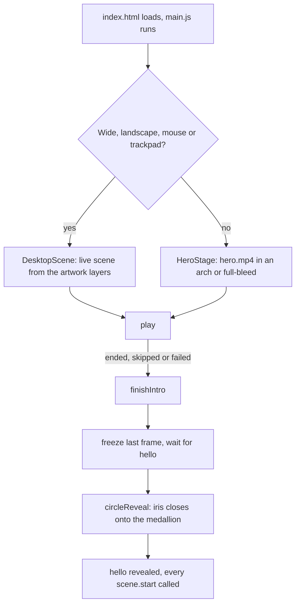
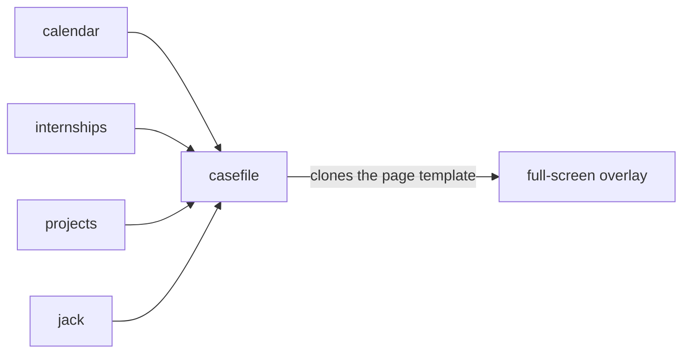

# Architecture

How the site is put together and why. For the folder layout and how to run it, see the [README](../README.md).

## The shape of it

It's one page, `index.html`, with no framework and no build step. Everything after the first paint is plain ES modules loaded with `<script type="module">`.

The page is in two layers:

- `#intro` sits on top and plays first.
- `<main id="hello">` sits underneath from the start, so when the intro finishes there's nothing left to load. It's set to `inert` until the handover.

Below the hello screen, the sections run in this order:

`about` → `contents` → `work` (the curtain) → `experience` → `worked` (the calendar) → `internships` (the bus) → `open-source` → `website-design` → the birds → `blogs` → `tools` → `table` → `jack` → `contact`.

## Boot sequence

`scripts/main.js` is the only entry point. It decides which intro to use, wires up every scene, and then waits.



A few details in there that aren't obvious:

- **Which intro.** The desktop scene is used when the viewport is at least 1100px wide, the primary input is a mouse or trackpad (`hover: hover` and `pointer: fine`) and the aspect ratio is at least 1.25. Everything else gets the film. The desktop path never downloads `hero.mp4`.
- **Autoplay.** Browsers can refuse autoplay with sound. `hero.play()` reports `'sound'`, `'muted'` or `'blocked'`. If it's blocked, a play button is shown and the sound is turned on from that tap. If the film hasn't fetched even its metadata after 12 seconds, the intro is skipped.
- **Reduced motion.** With `prefers-reduced-motion`, the film waits for a tap, the iris is replaced by a fade, and the scroll-driven scenes show their finished state.
- **Handover.** The transition has to end on the exact frame the film ended on, which is why `hero-final.jpg` must match the last frame of the video (see [assets.md](assets.md)).

## Scene modules

Each section has a module in `scripts/scenes/` with the same shape:

```js
export function createTools(root, { reduced }) {
  // find elements, set up state, register pages: no listeners yet
  return {
    start() { /* add scroll and resize listeners, start observing */ },
  };
}
```

`main.js` creates all of them up front and calls `start()` on each one only after the intro is over, so nothing competes with the opening for the main thread. `root` is always found by a `data-*` attribute (`[data-tools]`, `[data-cal]`, …) rather than a class, so styling changes don't break the wiring.

`reduced` is passed in so each scene can switch to its static version.

## Scroll-driven scenes

Most sections animate with scroll position rather than time. They all work the same way:

1. A tall wrapper (`.tools__walk`, `.table__walk`, …) gives the section a runway of scroll.
2. Inside it, a `position: sticky` stage stays fixed on screen while the wrapper scrolls past.
3. The module measures the runway once (and again on resize), then on each scroll computes a progress value between 0 and 1.
4. That progress is written out as CSS custom properties (`--blind`, `--lift`, `--serve`, …) or as an `is-down` / `is-in` class, and the CSS does the rest.

Scroll handlers are throttled with `requestAnimationFrame` and registered as `{ passive: true }`. The easing helpers (`clamp`, `segment`, `cubicBezier`, `ease`) are in `scripts/lib/motion.js`.

Because progress is derived from the scroll position and not from a running animation, scrolling back up reverses the scene exactly, and the state is always consistent with where you are on the page.

`scripts/ui/rail.js` reads the position directly instead of using an `IntersectionObserver`, because several sections pin themselves while they play and observers report those unreliably. It briefly switches sticky elements to `static` to measure where a section really starts.

## The case file overlay

The "know more" pages, the bus stops, the project pages and the skill pages all open in one shared full-screen overlay, `scripts/scenes/casefile.js`.



- A scene registers a page: `casefile.register(hash, { label, build, next })`. `build()` returns the content, cloned from a `<template>` in `index.html`, plus an optional `variant` that adds a `casefile--<variant>` class for styling (the kraft-paper bus stops use `ticket`, the website projects use `works`).
- `casefile.open(hash)` pushes a history entry (`#hash`), so the browser's Back button closes the page and returns to the same scroll position. Escape and the Back button in the overlay do the same.
- `next` names another registered page, which adds a "next:" link in the top bar.
- Any link inside an open page with `data-open-case="hash"` opens another registered page.

The page content lives in `<template>` tags rather than being built in JavaScript, so it can be read and edited as plain HTML and isn't parsed until someone opens it.

## Drawn art

Several parts of the site are drawn in code instead of shipped as images, so they're sharp at any size and cost no download:

| Module | What it draws |
| --- | --- |
| `curtainArt.js` | the olive stage curtain and its scalloped hem |
| `jamdani.js` | the woven Jamdani border, the khaki field and the Madras check, built from a grid of square "threads" |
| `busArt.js` | the G3 bus, plus a line-drawing version with numbered callouts |
| `intro/sceneArt.js` | the desktop intro's banner border, flourish, coins, toran and alpona |
| `lib/handDrawn.js` | wobbly lines and ruffles shared by the above |
| `lib/texture.js` | the paper grain, generated on a `<canvas>` as a tileable PNG |

Anything with randomness uses a seeded generator (`seeded()` in `handDrawn.js`, or an inline one) so a drawing is identical on every visit and every resize.

## Loading strategy

The aim is that only the intro's assets load during the intro.

- Images below the fold use `loading="lazy"`.
- Sections with CSS background pictures carry `data-lazy-bg`. `lazyBackgrounds.js` adds `is-near` when the section is within two screens, and the CSS only references the image under `.is-near`.
- `whenNear(el, cb)` does the same for scripts that need to fetch something (the birds in `flock.js`).
- The contents illustration has `data-src` / `data-srcset` and is only given a real `src` in `contents.start()`, after the intro.
- Big images ship at two widths with `srcset`, named by width (`-900`, `-1600`).

Fonts come from Google Fonts with `display=swap`. The two Bengali fonts are subset with `&text=` to the characters actually on the page; if you add Bengali text you have to add its characters to that list (see [content-guide.md](content-guide.md)).

## Accessibility

What's there:

- The hello screen is `inert` during the intro; the overlay is a `role="dialog"` with `aria-modal`, closes on Escape, and returns focus to what opened it.
- The section rail marks the current section with `aria-current`.
- Decorative images use `alt=""` and `aria-hidden`; content images have real alt text.
- `prefers-reduced-motion` is respected throughout (see above).

I haven't run an automated accessibility audit, so treat this as a list of things I did on purpose, not a conformance claim.

## The dev server

`tools/serve.mjs` is a small static server using only Node's built-in modules. It exists for one reason: Safari won't play `<video>` unless the server answers HTTP range requests, and `python -m http.server` doesn't. It also sends `Cache-Control: no-cache` so edits show up on refresh, and refuses to serve dotfiles or anything outside the project root.

## Trade-offs

- **No build step.** The page loads 21 stylesheets and loads scripts as separate modules. That's fine for a site this size on a CDN-backed host, and it means the repo is exactly what runs. The cost is no minification or bundling; if load time ever matters more than simplicity, a bundler would be the first thing to add.
- **Content is in HTML.** All copy lives in `index.html`, which is long (about 1,150 lines). It keeps content, markup and behaviour easy to follow for a single page, but it isn't a CMS and each new company or project is a copy-and-edit job (see the content guide).
- **No automated tests.** The only automated check is `npm run check`, which parses every script and confirms every referenced file exists. Everything else has been checked by hand in a browser.
